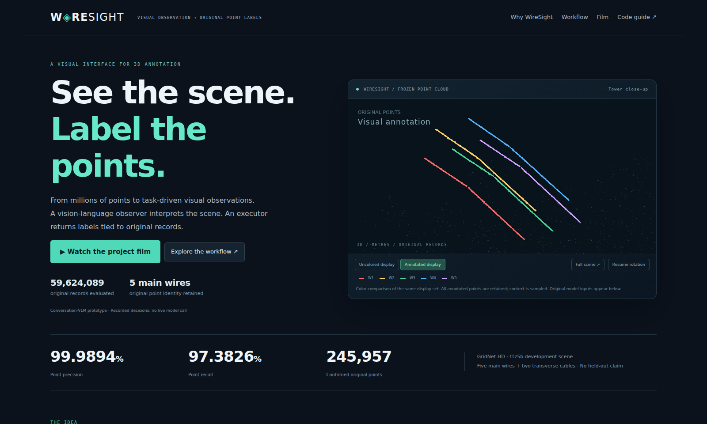
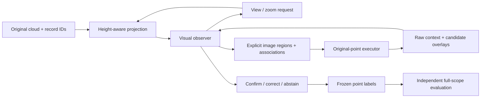

# WireSight

### A Visual Interface for 3D Annotation

**See the scene. Label the points.**

[Interactive demo](https://wangchuangshui.github.io/WireSight/demo/) · [Project film](https://wangchuangshui.github.io/WireSight/media/wiresight-demo.mp4) · [Dataset & reproduction](docs/DATASET.md) · [Observer guide](docs/OBSERVER_GUIDE.md) · [中文](docs/README.zh-CN.md)



How can a vision-language model work with a cloud of nearly 60 million points?

WireSight turns a large point cloud into **task-driven visual observations**, lets an observer interpret spatial relationships, and maps its explicit decisions back to **original point IDs**. Wires are the first demonstrated task. The open-source interface separates visual observation, semantic decisions and precise point execution.

- **Reuse visual understanding.** Top-down height views expose paths; side views expose sag and supports. This example did not train a dedicated 3D segmentation network.
- **Let questions guide observation.** The observer chooses views, zooms and fragment associations, then confirms, corrects or retracts candidates using recorded evidence.
- **Keep original-point identity.** Explicit multiview regions become traceable 3D labels, with action replay, frozen predictions and export readback checks.

The landing page leads with the real frozen 3D result. The evidence tour shows the actual input images and can overlay the observer's exact recorded top-view paths. The English film tells the observation-to-annotation story with real evidence, original point coordinates and synthetic narration.

## A real scene, with an explicit scope

| Scene | Original records | TP | FP | FN | Point precision | Point recall |
|---|---:|---:|---:|---:|---:|---:|
| GridNet-HD / t1z5b development scene | 59,624,089 | 245,931 | 26 | 6,610 | 99.9894% | 97.3826% |

The five main visual instances contain 233,548 points; two transverse cables add 12,409. Target raw classes are 5/6/7 (conductor and structural cables); ignored classes are 12/13/255. Every unknown target remains a false negative. All annotated points are retained in the display payload; only environmental context is sampled.

This is an **inspected development-scene conversation-VLM result**. It does not establish independent instance truth, complete wire endpoints/lengths, held-out generalization or unattended success. The weakest 10m region still has 80.7101% recall. Tour chapters 05–06 show a separate local revision, not merged into the full-scene result.

## Try the demo

[Open the public demo](https://wangchuangshui.github.io/WireSight/demo/) without signing in, or open `demo/index.html` directly and serve the release locally:

```bash
python tools/serve_demo.py --host 127.0.0.1 --port 8000
# Open http://127.0.0.1:8000/demo/
```

No model download, GPU or API key is needed to inspect the offline result. Display coloring is a comparison of the same display set; the original model-input projections are shown separately in the evidence tour.

## Replay a real example

Use **Python 3.12** for the pinned reproduction environment (the executor supports Python 3.10+, but the tested dependency pins require 3.12):

```bash
python3.12 -m venv .venv
source .venv/bin/activate
python -m pip install -e . -c requirements-tested.txt
OPENBLAS_NUM_THREADS=4 python tools/replay_example.py --out replay-output
python -m visual_annotation_v3.artifacts replay-output --las
```

On Windows, activate `.venv\Scripts\Activate.ps1` and set the thread environment variable separately. The output directory must be new.

The bundled real ROI has **867,479 original records and 25 saved actions**. A successful replay reports `point_labels_identical: true`, `model_invoked: false` and `ground_truth_read: false`. LAS export reads the result back to verify original IDs, instance IDs and coordinates.

This checks execution of stored visual choices. Fresh annotation requires a visual observer making new decisions.

## Reproduce the full result

The release includes all confirmed full-scene record IDs in a compact prediction, the exact dataset manifest, and the full recorded action chain. Download one pinned public LAS file, then recompute the score over all original records:

```bash
python tools/download_data.py --out data
python tools/evaluate_full_scene.py \
  --las data/t1z5b/lidar/t1z5b.las --out full-scene-metrics.json
```

Expected: `TP=245931`, `FP=26`, `FN=6610`, `matches_published_combined_metrics: true`.

For full saved-decision replay:

```bash
python tools/replay_dataset.py --scope full --dry-run
OPENBLAS_NUM_THREADS=4 python tools/replay_dataset.py \
  --scope full --las data/t1z5b/lidar/t1z5b.las --out full-replay
```

Full rendering can use substantial CPU memory. The included ROI is the fastest starting point. See [exact data, scope, hashes and reproduction levels](docs/DATASET.md).

## Use a new visual observer

```bash
python -m visual_annotation_v3.session prepare \
  --las /path/to/source.las --y0 30 --y1 60 --out runs/my_scene
python -m visual_annotation_v3.session act \
  --out runs/my_scene --action examples/first_look.json
python tools/observer_packet.py runs/my_scene
```

Actually inspect the generated images, then submit the next visual decision. New sessions use `context_v1` and `delta_v1`; historical replay preserves its recorded protocol. The package does not wire an unattended VLM endpoint, local Qwen, Point model or automatic geometric tracer. The current adapter supports LAS with a declared Y stripe.

Authoritative LAS fields: `source_record_id`, `vlm_instance_id`, `vlm_confirmed`. Instance 0 means unconfirmed, including unknown/background; it is not certified background. Cable subtypes are not assigned, and native `classification` remains unclassified.

## How it works



Local measurement supplies coordinates; it does not connect fragments across image rows/columns. The observer specifies the paths and regions. Projection is lossy: additional views supply evidence for overlap and contact questions. Original records stay local; observation/token efficiency and net gains over geometry baselines remain research questions. See [project meaning](docs/PROJECT_MEANING.md).

## Package map

```text
visual_annotation_v3/  Observation, selection, review, revision and export executor
examples/recorded_roi/ Real geometry-only quick replay
examples/full_scene/   Frozen compact labels + exact dataset manifest
examples/full_trace/   Recorded actions and explicit full-scene associations
demo/                 English landing page, evidence tour, film source and original archive
media/                English MP4, narration, storyboard, captions and credits
tools/                Data download, replay, score recomputation and release checks
evidence/             Original metrics, hashes and actual validation reports
docs/                 Data/protocol/reproduction guides; Chinese supplement
```

## Verify and contribute

```bash
python -m pip install -r requirements-dev.txt
python -m playwright install chromium
python -m pytest -q
python tools/validate_demo.py
python tools/verify_release.py
```

Contributions can improve observer adapters, view selection, input formats and independently declared scene evaluations. Quality reports should identify the observer, scope, unknown-point treatment and development refinements. See [CONTRIBUTING.md](CONTRIBUTING.md).

## License and attribution

Software: Apache-2.0. GridNet-HD-derived geometry and visual assets: CC BY 4.0 with separate [data attribution](docs/DATA_ATTRIBUTION.md). Synthetic narration and film production sources are credited in [media/CREDITS.md](media/CREDITS.md). No dataset-author endorsement is implied.

GridNet-HD: Antoine Carreaud, Shanci Li, Malo De Lacour, Digre Frinde, Jan Skaloud, Adrien Gressin, 2026. [Dataset](https://huggingface.co/datasets/heig-vd-geo/GridNet-HD) · [Paper](https://arxiv.org/abs/2601.13052).
