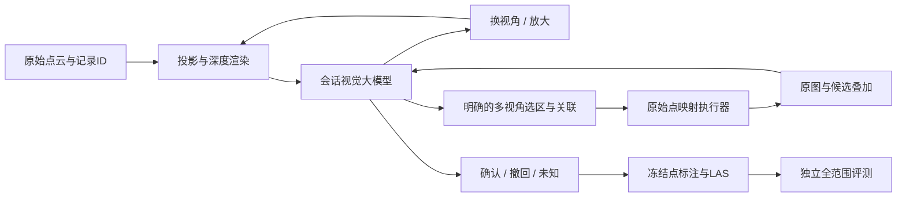

> 开源主入口为英文 [README](../README.md)。完整数据版本、下载、全场景指标重算及动作回放见 [数据复现说明](DATASET.md)。

# WireSight

**让大模型通过视觉观察，完成可追溯的三维点标注。**

[English](README.en.md) · [交互主页](../demo/index.html) · [英文项目介绍](../media/wiresight-demo.mp4) · [独立3D场景](../demo/scene-3d.html)


五千九百多万个原始点，如何交给大模型标注？WireSight 从俯视高程图发现电线，通过多视角判断空间关系，再把视觉选择落回原始点ID。

**三个可复用的组成部分：**

- **视觉观察接口**：利用现有模型的视觉理解，观察高程投影与局部图像；本次示例未训练专用3D分割网络。
- **任务驱动的判断过程**：模型选择视角、关联线段、指定选区，并根据真实证据确认、纠错或保留未知。
- **原始点执行器**：坐标、深度和记录ID留在本地，图像选择能成为三维标注，并留下可检查的来源与回放。

**电线是第一个已走通的开发任务，开源的是从观察到点标注的接口与原型。** 首页可旋转真实五线点云、切换展示着色；证据导览可在原始俯视图上叠加模型实际给出的五条路径。影片用英文合成旁白说明模型怎样作判断，以及别人可以复用什么。

页面和影片回放保存的会话视觉决策，不发起新模型调用。新标注需要有视觉能力的观察者逐图驱动工具。完整原始点保留在执行器中；当前未量化观察/token效率，也未通过等条件对照证明相对几何方法的净收益。参见 [项目意义](PROJECT_MEANING.md) 与 [介绍方式及证据边界](PRESENTATION.md)。

## 先看成果

无需安装 Python 包或下载数据，直接打开 `demo/index.html`。主页先展示可交互的3D成果，随后有八步证据导览：俯视发现 → 拆开重叠 → 关联线段 → 批准候选 → 撤回歧义 → 纠正定位 → 返回3D → 独立评测。

- 首屏：真实五线3D，旋转与全场景切换；未着色/彩色是同一展示点集的着色对照，原始模型输入见证据导览。
- 导览左侧：当时实际观察的图，可切换视角、原图和候选叠加，点击放大；俯视路径叠加来自保存的模型动作。
- 中间：模型判断的中文导读，可展开当时记录的理由与工具参数。
- 右侧：最终冻结点云，可旋转、平移、缩放、逐线查看，切换塔旁近景与全场景。
- `demo/audit/index.html`：完整历史步骤、原图、叠加图、未决问题和指标。
- `media/wiresight-demo.mp4`：1600×900、H.264视频与AAC音频、94秒、合成英文旁白与英文字幕。

也可以启动仅绑定本机的静态预览：

```bash
python -m http.server 8000 --bind 127.0.0.1
# 浏览器打开 http://127.0.0.1:8000/demo/
```

## 大模型到底做了什么？

| 主体 | 负责的决定或操作 | 可查看的证据 |
|---|---|---|
| 大模型视觉观察者 | 发现五条线、选择新视角、关联片段、指定选区、支持/矛盾/看不清判断、纠正定位 | 导览01–06，完整LOOK/PROPOSE/REVIEW/CONFIRM记录 |
| 本地执行器 | 渲染投影与深度、提供局部坐标、把明确选区映射到原始点、校验哈希、保存和导出 | `visual_annotation_v3/`，真实ROI回放 |
| 独立评测器 | 冻结后读取真值，计算完整声明范围上的点级指标 | `evidence/metrics.json` |



局部测量工具不连接不同图像行列里的点簇。线段关联与折线路径由观察者明确指定。二维选区的多视角交集用于定位原始点，不会沿几何切向延长，也不会在选区之外补点。

## 当前结果与范围

| 数据范围 | 原始记录 | TP | FP | FN | P | R |
|---|---:|---:|---:|---:|---:|---:|
| GridNet-HD / t1z5b 全场景开发结果 | 59,624,089 | 245,931 | 26 | 6,610 | 99.9894% | 97.3826% |

- 目标为原始语义类5/6/7（导线与结构缆线），目标真值共252,541点；忽略类12/13/255。本结果没有忽略类预测点。
- 五条主线共233,548个已标点，另两条横向线12,409点。**五线颜色表示视觉实例，不是已经独立验证的实例真值。**
- 召回分母包含整个场景的目标点，未确认目标仍计为FN。3D点集保留全部已标点，环境仅抽样74,690点；显示抽样不影响指标。
- 最弱10米区段仍是650–660m，R=80.7101%。逐线端点、长度覆盖与连接完整性尚未验收。
- 导览05–06来自**单独的塔旁局部修订**，没有合入本页展示的全场景版本；其成绩不与全场景混算。

这是已查看开发场景上的会话视觉结果，尚未证明无人值守标注成功率或跨场景泛化。它可以作为可审计的开源原型使用，不能据此认定已达到自动生产标注系统的标准。

## 运行一个真实决策回放

Python 3.12（固定依赖验收版本）；回放示例不需要 GPU、模型权重、API 密钥或完整数据集。

```bash
python -m venv .venv
# Linux / macOS
source .venv/bin/activate
# Windows PowerShell: .venv\Scripts\Activate.ps1
python -m pip install -e .
OPENBLAS_NUM_THREADS=4 pythontools/replay_example.py --out replay-output
python -m visual_annotation_v3.artifacts replay-output --las
```

Windows 请先设置线程环境变量或直接运行不带前缀的 `python` 命令。输出目录必须不存在。

示例包含t1z5b的30–60m原始ROI几何、保存的视觉动作和参考标注。成功回放必须得到 `point_labels_identical: true`；LAS导出会读回核对原始ID、实例和坐标。**这是保存决策的执行器复现，不是模型重新推理成功。** 示例保留历史 `legacy_v0` 协议；新会话默认采用更严格的 `context_v1 / delta_v1`。

## 标注你自己的点云

```bash
python -m visual_annotation_v3.session prepare --las /path/to/source.las --y0 30 --y1 60 --out runs/my_scene
python -m visual_annotation_v3.session act --out runs/my_scene --action examples/first_look.json
```

查看工具生成的图片，再根据实际视觉判断编写下一步动作。不能靠复制旧场景的折线来证明新场景有效。完整观察与复核流程见 [观察者指南](OBSERVER_GUIDE.md)。冻结后可用 `artifacts` 导出；有真值时用 `evaluate` 单独评测。

LAS权威字段为 `source_record_id`、`vlm_instance_id`、`vlm_confirmed`。实例0表示未确认，包含背景和未知；不表示已验证背景。原生 `classification` 保持未分类，模型没有分配导线子类。

## 仓库结构

```text
visual_annotation_v3/     观察、选点、复核、修订、回放与导出执行器
examples/recorded_roi/    真实的小区域回放，不含真值字段
examples/first_look.json  新观察的起点
demo/                   首页导览、完整证据、独立3D场景
media/                  MP4、字幕、预览图、录制脚本的关键帧
evidence/               指标、来源哈希、发布验收记录
docs/                   英文说明、观察者指南、数据署名、复现边界
tools/                  回放示例、浏览器验收、视频录制、包完整性校验
tests/                  协议失败情形与导出一致性测试
```

未打包原始全场景LAS、模型权重、失败本地模型入口、多分类系统或历史9GB归档。完整全场景的重新评测需要原始数据和冻结标注数组，不能从网页展示点集重新计算同一个P/R。详见 [复现范围](REPRODUCIBILITY.md)。

## 验证与贡献

```bash
python -m pip install -r requirements-dev.txt
python -m playwright install chromium
python -m pytest -q
pythontools/validate_demo.py
pythontools/verify_release.py
```

欢迎改进视觉观察协议、模型适配器、数据输入和独立场景评测。提交质量结果时，请注明观察者来源、评测范围、未知点处理与是否开发后修订。问题报告模板位于 `.github/ISSUE_TEMPLATE/`。

## 许可证与数据署名

软件按 Apache-2.0 发布；数据衍生素材遵循 GridNet-HD 的 CC BY 4.0，二者分别列明。参见 [LICENSE](../LICENSE)、[NOTICE](../NOTICE) 和 [数据署名](DATA_ATTRIBUTION.md)。本项目未获数据集作者背书。

GridNet-HD: Antoine Carreaud, Shanci Li, Malo De Lacour, Digre Frinde, Jan Skaloud, Adrien Gressin, 2026. [数据集](https://huggingface.co/datasets/heig-vd-geo/GridNet-HD) · [论文](https://arxiv.org/abs/2601.13052).
